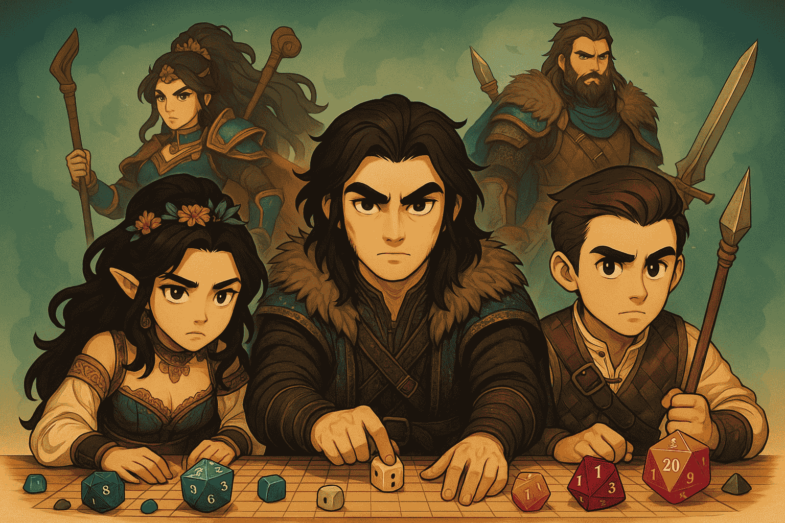

# 🧙‍♂️ Chapter 1: Creating Your First Agent



# 🎯 Quest Objective

Summon your first agent with LangChain.js: a Game Master that answers an adventurer with nothing more than `createAgent`, a system prompt and one call. Along the way, turn on console tracing to see what happens between your code and the model.


Open and modify [`1_langchain_basics/simple_agent.ts`](../1_langchain_basics/simple_agent.ts). You'll complete the `TODO` comments to create your first AI agent. `createAgent` and the shared `model` are already imported.

## Step 1: Enable Debug Logging

```typescript
// TODO: Step 1 - Import ConsoleCallbackHandler from @langchain/core/tracers/console to see what your agent is thinking
```

Before creating your agent, get ready to watch its internal reasoning process. A LangChain agent prints nothing on its own. Instead, every run fires **callbacks**: events for each step of the run (the agent graph, each model call, each tool call). `ConsoleCallbackHandler` is a callback handler that prints all of them to the terminal. You import it in this step and use it in Step 3.

It is verbose: it shows the messages sent to the model and the full response that comes back. Drop it once you have seen enough. See [LangChain observability](https://docs.langchain.com/oss/javascript/langchain/observability) for the hosted alternative, LangSmith.

## Step 2: Create Your Agent

```typescript
// TODO: Step 2 - Create the agent with createAgent, the shared model and the following system prompt: "You are a game master for a Dungeon & Dragon game"
```

The system prompt defines your agent's role, personality, and knowledge base. Pass `createAgent` an object with the `model` and a `systemPrompt`. See [agents](https://docs.langchain.com/oss/javascript/langchain/agents) in the documentation.

In LangChain the model is always explicit. The workshop's model is set up for you in `shared/model.ts`: Claude Sonnet 4.6 on Amazon Bedrock, through `ChatBedrockConverse`. To try another model later, change it there; see the [`ChatBedrockConverse` integration](https://docs.langchain.com/oss/javascript/integrations/chat/bedrock_converse) and [models](https://docs.langchain.com/oss/javascript/langchain/models).

## Step 3: Test Your Agent

```typescript
// TODO: Step 3 - Invoke your agent with a basic query such as "Hi, I am an adventurer ready for adventure!",
//   passing callbacks: [new ConsoleCallbackHandler()] in the options to log every step, then print the last message's text
```

Time to test your agent! An agent's input is its state: an object with a `messages` list. Call `await agent.invoke(...)` with one user message, `{ role: 'user', content: '...' }`, and pass `{ callbacks: [new ConsoleCallbackHandler()] }` as the second argument. The result is the new state, with the whole conversation in `messages`; the agent's answer is the last one, and its `.text` is the text. See [invocation](https://docs.langchain.com/oss/javascript/langchain/agents) in the documentation.

## Step 4: Testing Your Creation

Once you've completed all TODOs, run your script from the repository root:

```bash
npm run ch1
```

The terminal first fills up with the tracer's output: `[chain/start]`, `[llm/start]`, `[llm/end]` and `[chain/end]` entries, showing the system prompt and your message going to the model and its response coming back. Then your `console.log` prints the answer: your Game Master should respond with enthusiasm and set the scene for a D&D adventure!

# 🎉 Quest Complete!

Congratulations! You've created your first AI agent using LangChain.js.

**What you've learned:**
- ✅ How to trace a run with `ConsoleCallbackHandler` to observe your agent's reasoning
- ✅ How to create an agent and define its behavior with a system prompt
- ✅ How to invoke your agent and read its answer

**Next Adventure**: Head to [Chapter 2](2_prebuilt_tools.md) to learn about equipping your agent with tools!

---

_"A well-configured agent is worth its weight in gold!"_ 🧙‍♂️✨
