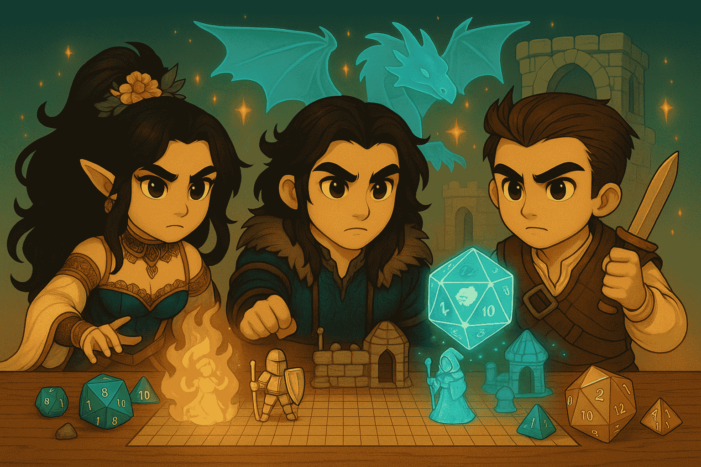

# 🌐 Chapter 4: MCP Integration (Model Context Protocol)



# 🎯 Quest Objective

Serve `roll_dice` through the Model Context Protocol: build an MCP server that exposes the dice service, then connect the Game Master to it with LangChain's [MCP adapters](https://docs.langchain.com/oss/javascript/langchain/mcp).

**What is MCP?** The [Model Context Protocol](https://modelcontextprotocol.io/) is an open standard that defines how an AI application talks to external tools and data sources. An **MCP server** exposes tools (functions with a name, a description and a JSON schema, exactly what you printed in Chapter 3) over a standard transport: stdio for a local process, streamable HTTP for a remote one. An **MCP client**, your agent, connects to the server, lists its tools and calls them, without any custom code for that particular server. In Chapter 3 the `roll_dice` tool lived inside the agent's process; with MCP it runs in its own server, possibly on another machine or written in another language, and any number of agents can share it. Think of it as a universal plug between agents and tools.


Create an MCP system with two components:
1. **An MCP server** ([`4_mcp_integration/dice_roll_mcp_server.ts`](../4_mcp_integration/dice_roll_mcp_server.ts)): exposes the dice rolling service
2. **An MCP client** ([`4_mcp_integration/gamemaster_mcp_client.ts`](../4_mcp_integration/gamemaster_mcp_client.ts)): connects to the server and uses its tools

The `rollDice` function is the one you built in Chapter 3, now with a log line for each roll, and `ROLL_DICE_DESCRIPTION` is a full tool description. Only the way the tool is served changes, from `tool()` to an MCP server.

## Part 1: Setting Up the MCP Server (`dice_roll_mcp_server.ts`)

The server uses the official [MCP TypeScript SDK](https://github.com/modelcontextprotocol/typescript-sdk), `@modelcontextprotocol/sdk`, not LangChain: an MCP server doesn't care which framework its clients use. The Express app, the `/mcp` route and the port are already written.

### Step 1: Create the MCP Server

```typescript
// TODO: Step 1 - Import McpServer from @modelcontextprotocol/sdk/server/mcp.js
```
```typescript
// TODO: Step 1 - Create an McpServer named "dice-roll"
```

Import `McpServer`, then fill in the object passed to `new McpServer(...)` inside `createServer()`: a `name`, `"dice-roll"`, and a `version` such as `"1.0.0"`. The server sends both to each client when it connects; the model never sees them, only the tools.

### Step 2: Expose `rollDice` as an MCP Tool

```typescript
// TODO: Step 2 - Register rollDice as the MCP tool "roll_dice" with registerTool
//   - description: ROLL_DICE_DESCRIPTION
//   - inputSchema: { faces: z.number().int().default(6).describe('Number of faces on the die, 1 or more. Use 20 for a d20, 6 for a d6, 100 for a percentile die. Defaults to 6.') }
//   - callback: return { content: [{ type: 'text', text: String(rollDice(faces)) }] }
```

Call `mcp.registerTool(name, config, callback)`. This is the Chapter 3 move again: there `tool()` made the function a tool for one agent, here `registerTool` makes it a tool for any MCP client. The pieces are the same, a name, a description and a zod schema, except that `inputSchema` is a plain object of zod fields rather than a `z.object(...)`. An MCP tool returns a list of **content** blocks, so the callback wraps the roll in a text block.

### Step 3: Choose the Transport

```typescript
// TODO: Step 3 - Create the streamable HTTP transport: a StreamableHTTPServerTransport with sessionIdGenerator: undefined (stateless)
```

In the `/mcp` route, create a `StreamableHTTPServerTransport` named `transport`; the lines after the TODO connect the server to it and hand it the request. MCP defines two standard transports. With **stdio**, the client launches the server as a child process and talks to it through stdin/stdout: simple, but the server lives and dies with that one client. With **streamable HTTP**, the server is an independent process listening on a URL, here `http://localhost:8002/mcp`, and any number of clients can connect over the network, from another terminal, another machine or the cloud. That is what we need: the Game Master runs in a second terminal, and in Chapter 5 it shares the same dice server.

`sessionIdGenerator: undefined` makes the server **stateless**: every request gets a fresh `McpServer` and transport, so the server keeps nothing between calls. A dice roller needs no memory.

### Step 4: Launch the Server

```bash
npm run ch4:server
```

You should see:

```
Starting D&D Dice Roll MCP Server...
2026-10-15T09:00:00.000Z - INFO - MCP server listening on http://localhost:8002/mcp
```

Leave this terminal open: the server has to stay up while the client talks to it.

## Part 2: Creating the MCP Client (`gamemaster_mcp_client.ts`)

### Step 1: Create the MCP Client

```typescript
// TODO: Step 1 - Import MultiServerMCPClient from @langchain/mcp-adapters
```
```typescript
// TODO: Step 1 - Create a MultiServerMCPClient with one server, dice: { url: "http://localhost:8002/mcp", transport: "http" },
//   and prefixToolNameWithServerName: false so the tool keeps its name, roll_dice
```

Create a `MultiServerMCPClient` named `mcpClient`, with an `mcpServers` map holding one server, `dice`. As its name says, the client can hold several servers; each entry is the server's URL and transport (`"http"` is streamable HTTP). Set `prefixToolNameWithServerName: false` too: the adapter would otherwise prefix each tool with its server's key, and the model would see `dice_roll_dice`. See [MCP](https://docs.langchain.com/oss/javascript/langchain/mcp) in the documentation.

### Step 2: Add MCP Tools to Your Agent

```typescript
// TODO: Step 2 - Add the MCP tools (await mcpClient.getTools()) to the gamemaster agent
```

`await mcpClient.getTools()` connects to the server, lists its tools and returns them as ordinary LangChain tools: pass them as the agent's `tools`. Calling one of them sends the call to the server. The last line of the file, `await mcpClient.close()`, closes the connection so the script can exit.

### Step 3: Launch the Client

Open a **second terminal** (the server keeps running in the first one), go to the repository root and run:

```bash
npm run ch4:client
```

Here is what happens. The client connects to `http://localhost:8002/mcp` and asks the server for its tool list. It receives the `roll_dice` specification, built this time by the MCP server from `ROLL_DICE_DESCRIPTION` and the zod schema. The client sends the same request as Chapter 3: Lady Luck rolls four ability scores with 4d6 drop lowest, 16 rolls. The difference is where they happen. Keep an eye on the server terminal: every roll arrives there as a `🎲 DICE ROLL: d6 = …` log line, 16 of them, while the narration and the `🔧 Tool: roll_dice` lines appear in the client terminal. Same agent, same tool, but the dice now live in another process.

Once the character is created, the client exits on its own. If you plan to continue with Chapter 5, keep the server terminal running: the Game Master will roll its dice through this same server.

# 🎉 Quest Complete!

Congratulations! You've built an MCP server and client, and connected your agent to a tool served over MCP.

**What you've learned:**
- ✅ How to create an MCP server that exposes a tool (`McpServer`, `registerTool`)
- ✅ How to serve it over streamable HTTP
- ✅ How to connect an agent to it with `MultiServerMCPClient`

**Next Adventure**: Head to [Chapter 5](5_subagents.md), where you'll orchestrate a team of specialized agents!

---

_"A well-connected system is stronger than any single agent."_ 🌐✨
