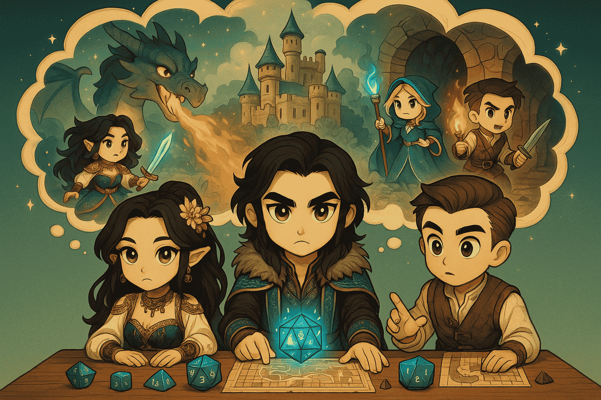

# 🏰 Chapter 5: The Grand Alliance - Subagents



# 🎯 Quest Objective

Assemble the full party: give the Rules Agent a knowledge base, make the Rules Agent and the Character Agent **subagents**, then build a Game Master orchestrator that delegates to both, rolls dice through the MCP server from Chapter 4 and returns its story as structured output.

**What is a subagent?** A subagent is an agent that another agent calls as a tool. The Game Master doesn't answer rules questions itself: it calls the `rules_agent` tool, and behind that tool a whole agent, with its own system prompt and its own tools, does the work and returns its answer. The Game Master's context stays short (it sees the answer, not the search results behind it), and each specialist only carries the tools it needs. See [subagents](https://docs.langchain.com/oss/javascript/langchain/multi-agent/subagents) in the documentation.

> **Coming from the Strands workshop?** There, the Rules and Character agents were separate services on ports 8000 and 8001, reached over the A2A protocol. Here they run inside the Game Master's process. The roles, prompts and tools are the same, but there is no agent card, no A2A server and no A2A client.

## System Architecture

```
      Rules Agent            Character Agent
     (rules_agent)          (character_agent)
          │                        │
          │ query_dnd_rules        │ create / find / list characters
          ▼                        ▼
   Chroma knowledge base     characters.json
       (port 8005)
          │                        │
          └──────────┬─────────────┘
                     │ subagents, called as tools
          Game Master Orchestrator ────── roll_dice ──────▶ Dice MCP server
               (port 8009)                                  (port 8002, Chapter 4)
```

You build a system with three specialized agents that work together:

- **Rules Agent**: answers questions about D&D rules and mechanics, in [`5_subagents/agents/rules_agent/rules_agent.ts`](../5_subagents/agents/rules_agent/rules_agent.ts)
- **Character Agent**: handles character creation and lookup, in [`5_subagents/agents/character_agent/character_agent.ts`](../5_subagents/agents/character_agent/character_agent.ts)
- **Game Master Orchestrator**: coordinates them for gameplay and serves the API, in [`5_subagents/agents/gamemaster_orchestrator/gamemaster_orchestrator.ts`](../5_subagents/agents/gamemaster_orchestrator/gamemaster_orchestrator.ts)

## Part 1: Setting Up the Rules Agent

First, create a **knowledge base** for the Rules Agent. The D&D Basic Rules PDF must be processed and stored in ChromaDB (a vector database) so the agent can query it for rules questions.

### Creating the Knowledge Base

**⚠️ REQUIRED**: You must complete this setup before the Rules Agent can work.

#### Step 1: Download the D&D Rules

Get the **D&D Basic Rules 2018 PDF** from Wizards of the Coast:
- Download the [rule book](https://media.wizards.com/2018/dnd/downloads/DnD_BasicRules_2018.pdf)
- **Important**: name it exactly `DnD_BasicRules_2018.pdf`

#### Step 2: Place the PDF in the Correct Folder

- Put `DnD_BasicRules_2018.pdf` in the `5_subagents/utils/` folder
- It should be next to `create_knowledge_base.ts`

#### Step 3: Start the Chroma Server

The JavaScript Chroma client talks to a Chroma **server** rather than embedding the database in your process, so Chroma runs as its own service. Open a new terminal at the repository root and start it:

```bash
npm run ch5:chroma
```

The `chroma` command comes with the `chromadb` npm package, so no Python is needed. The server listens on port 8005 and stores its data in `5_subagents/utils/dnd_knowledge_base/`. Leave this terminal open: the Rules Agent queries this server on every rules question.

#### Step 4: Build the Knowledge Base

In another terminal, at the repository root:

```bash
npm run ch5:kb
```

**What the script does.** [`unpdf`](https://www.npmjs.com/package/unpdf) reads the PDF page by page and extracts the text, minus the footer printed on almost every page. Each page is cut into passages of about 1,000 characters that overlap by 200, so a rule split across two passages stays findable, and the page number is kept with each passage. The passages are sent to the Chroma collection `dnd_basic_rules`, and every passage is turned into a vector with Chroma's default embedding model, `all-MiniLM-L6-v2`, downloaded on first run and cached afterwards: two passages about the same thing end up with vectors close to each other. Later, when the Rules Agent calls its tool, the question is turned into a vector the same way and the three closest passages come back with their page numbers. No LLM is involved in that lookup, it is pure semantic search; the model only reads the passages afterwards to write its answer.

Verify that the knowledge base was created:
- The script ends with `Knowledge base created (... passages in 'dnd_basic_rules')` and `Knowledge base creation complete!`
- `5_subagents/utils/dnd_knowledge_base/` exists, with `chroma.sqlite3` inside

### Configure the Rules Agent

In `rules_agent.ts`, the `query_dnd_rules` tool is written for you: it sends the question to the Chroma collection and formats the three passages it gets back. Complete the `rulesAgent`.

Until now nobody but you talked to your agents. This one is talked to by another agent, the Game Master, so it needs what any tool needs: a **name** to be called by and a **description** saying when to call it. `createAgent` accepts both. In Part 3, the `subagentTool` function turns the agent into a tool and copies its name and description onto it.

#### Step 1: Add the Tool

```typescript
// TODO: Step 1 - Add the queryDndRules tool to the agent
```

Same as in Chapters 3 and 4: the tool is what the agent can do, here look up a rule in the knowledge base.

#### Step 2: Add the Name

```typescript
// TODO: Step 2 - Add the name "rules_agent" to the agent
```

The `name` becomes the name of the Game Master's tool, so it follows tool-name rules: letters, digits, underscores and hyphens, no spaces. The Game Master's system prompt refers to its subagents by these names.

#### Step 3: Add the Description

```typescript
// TODO: Step 3 - Add the description "D&D 5e rules lookup: fast, page-referenced answers from the Basic Rules knowledge base." to the agent
```

This is what the Game Master reads to decide which agent to ask, so it says what the agent is good at, not how it works.

The Rules Agent is not a service: there is nothing to launch. The Game Master imports it in Part 3.

## Part 2: Setting Up the Character Agent

The **Character Agent** manages character creation and lookup. It comes with three pre-built tools:

- **`create_character`**: creates new characters with stats
- **`find_character_by_name`**: looks up characters by name
- **`list_all_characters`**: lists all characters in the database

The characters are stored in `5_subagents/agents/character_agent/characters.json`, which already holds one character, Arnaud.

### Configure the Character Agent

In `character_agent.ts`, complete the `characterAgent`. Same three steps as for the Rules Agent, with this agent's tools, name and description.

#### Step 1: Add the Tools

```typescript
// TODO: Step 1 - Add the createCharacter, findCharacterByName and listAllCharacters tools to the agent
```

Three tools this time; the agent picks the right one from their descriptions.

#### Step 2: Add the Name

```typescript
// TODO: Step 2 - Add the name "character_agent" to the agent
```

#### Step 3: Add the Description

```typescript
// TODO: Step 3 - Add the description "D&D character management: creates characters (ability scores rolled 4d6 drop lowest), stores them, finds and lists them." to the agent
```

## Part 3: Setting Up the Game Master Orchestrator

The **Game Master Orchestrator** coordinates all agents and serves as the main API endpoint. It integrates:
- The Rules Agent (as a subagent)
- The Character Agent (as a subagent)
- The dice service (the MCP server from Chapter 4)

The HTTP API around it is written for you, with [Express](https://expressjs.com/): `POST /inquire` runs one Game Master turn, and `GET /messages`, `GET /user/:userName` and `GET /health` serve the web interface of Chapter 6.

### Configure the Game Master Agent

#### Step 1: Create the MCP Client for Dice Rolling

```typescript
// TODO: Step 1 - Create a MultiServerMCPClient with one server, dice: { url: "http://localhost:8002/mcp", transport: "http" },
//   and prefixToolNameWithServerName: false so the tool keeps its name, roll_dice
```

Same client as in Chapter 4, named `mcpClient`.

#### Step 2: Turn the Subagents into Tools

```typescript
// TODO: Step 2 - Turn the rulesAgent and the characterAgent into tools with subagentTool
```

Read `subagentTool`, a little further up in the file. It builds a tool with the subagent's `name` and `description` and a single argument, `request`. When the Game Master calls the tool, it invokes the subagent with that request as a fresh conversation, and returns the subagent's last message as the tool's result. Call it once for each agent and keep the two tools, for example in a `subagents` array.

Each call starts a new conversation with the subagent: it remembers nothing between calls. That is deliberate. The Game Master holds the story, and the specialists answer one question at a time.

#### Step 3: Add the Tools

```typescript
// TODO: Step 3 - Add the MCP tools (await mcpClient.getTools()) and the subagent tools to the agent
```

The Game Master gets three tools: `roll_dice` from the dice server, `rules_agent` and `character_agent`. Pass them together in `tools`.

#### Step 4: Force Structured Output

By default, an agent replies with free-form text. **Structured output** makes the model return an object that matches a schema you define, here a zod schema. LangChain validates it and returns it next to the messages, in the result's `structuredResponse`. See [structured output](https://docs.langchain.com/oss/javascript/langchain/structured-output) in the documentation.

```typescript
// TODO: Step 4 - Force the response to use the StoryOutput schema (responseFormat)
```

We have coded `StoryOutput` for you, a little further up in the file: the schema of one Game Master turn, with `response` (the narration), `actions_suggestions` (what the player could do next), `details` (which tools and agents were used) and `dice_rolls` (each roll with its type, result and reason). Pass it as `responseFormat`. Here is an example:

```json
{
  "response": "The die tumbles across the table and lands on a 13! You are quick off the mark as the chaos of combat erupts around you.",
  "actions_suggestions": ["Draw your weapon", "Look for cover", "Shout a warning to your allies"],
  "details": "roll_dice (d20) through the dice server",
  "dice_rolls": [{"dice_type": "d20", "result": 13, "reason": "initiative roll"}]
}
```

We need this shape because the web interface you will play with in Chapter 6 renders those fields separately: parsing free-form prose would be fragile, whereas a guaranteed JSON shape keeps the UI reliable. That is also why the keys are snake_case.

Notice the `.meta({ title: 'StoryOutput' })` at the end of the schema. Under the hood, LangChain asks the model for structured output by giving it one more tool, named after the schema's title. Without a title it generates a new name on every request, and on a conversation that goes on across requests the model can call an old name that no longer exists.

#### Memory: the Checkpointer

Look at the agent's last option, given code: `checkpointer: new MemorySaver()`, and the `config` below it, `{ configurable: { thread_id: 'dnd-game' } }`. Each `/inquire` request sends only the new question. The **checkpointer** saves the conversation after each turn, under the **thread id** in the config, and loads it back at the start of the next one, so the Game Master remembers the story. A `MemorySaver` keeps it in memory, so a restart starts a new campaign; Chapter 7 saves it on disk. All requests share the one thread, so this Game Master runs one game at a time. See [short-term memory](https://docs.langchain.com/oss/javascript/langchain/short-term-memory).

#### Step 5: Launch the Game Master

Chapter 5 runs three services side by side, each in its own terminal, from the repository root:

| Terminal | Command | Port |
|---|---|---|
| 1 | `npm run ch4:server` (the dice MCP server from Chapter 4) | 8002 |
| 2 | `npm run ch5:chroma` (the Chroma server holding the rules knowledge base) | 8005 |
| 3 | `npm run ch5:gamemaster` | 8009 |

If the dice server and Chroma are still running from earlier, only start the third:

```bash
npm run ch5:gamemaster
```

You should see `D&D Game Master API listening on http://localhost:8009`.

## Part 4: Test the System

The Game Master is an Express application listening on port 8009. Each curl command below sends a `POST` request to its `/inquire` endpoint with a JSON body holding your question, exactly what a web page or any other client would do. Open a **fourth terminal** for the commands themselves and run them there (or, if you have a REST client, use the [`5_subagents/test/test.http`](../5_subagents/test/test.http) file we prepared for these tests):

```bash
# Query D&D rules
curl -X POST http://127.0.0.1:8009/inquire \
  -H "Content-Type: application/json" \
  -d '{"question": "What are the rules for dexterity checks?"}'
```

```bash
# Create a new character
curl -X POST http://127.0.0.1:8009/inquire \
  -H "Content-Type: application/json" \
  -d '{"question": "Create a character named Thorin, a Dwarf Fighter with strength 16, dexterity 12, constitution 15"}'
```

```bash
# Look up a character
curl -X POST http://127.0.0.1:8009/inquire \
  -H "Content-Type: application/json" \
  -d '{"question": "What is Thorin'\''s constitution?"}'
```

```bash
# Roll for initiative
curl -X POST http://127.0.0.1:8009/inquire \
  -H "Content-Type: application/json" \
  -d '{"question": "Roll a d20 for initiative!"}'
```

Watch the terminals while a request runs:

- **Game Master terminal**: `Processing request...`, then, once the turn is over, each tool call of the turn (`🔧 Tool: rules_agent {"request":"..."}`, `🔧 Tool: roll_dice {"faces":20}`, ...) with its result, and the structured response. That last one shows up as a tool call too, `🔧 Tool: StoryOutput {...}`: that is how LangChain gets the structured output from the model. The Character Agent runs in this process too, so its tools' logs appear here as well: `🔍 Searching for character with name: 'Thorin'`, `✅ Created character Thorin (Fighter Dwarf) with id ...`.
- **Dice server terminal**: a `🎲 DICE ROLL` line for every roll.

The Rules Agent's own tool calls are not printed: `subagentTool` returns only its final answer, which is what you see as the `rules_agent` result.

The answer you get back is JSON with a `response` field holding the `StoryOutput` object: `response`, `actions_suggestions`, `details` and `dice_rolls`.

# 🎉 Quest Complete!

Congratulations! You've built a complete multi-agent D&D system with agent orchestration.

**What you've learned:**
- ✅ Setting up a ChromaDB knowledge base for the Rules Agent
- ✅ Giving agents a name and a description so other agents can call them
- ✅ Turning agents into tools for an orchestrator (the subagent pattern)
- ✅ Orchestrating specialized agents together with MCP tools
- ✅ Keeping a conversation across requests with a checkpointer and a thread id
- ✅ Forcing structured JSON output with `responseFormat`

**Next Adventure**: Head to [Chapter 6](6_ui_testing.md), where you'll test your Game Master with a web interface!

---

_"Many hands make light work, and many agents make powerful systems."_ 👥✨
