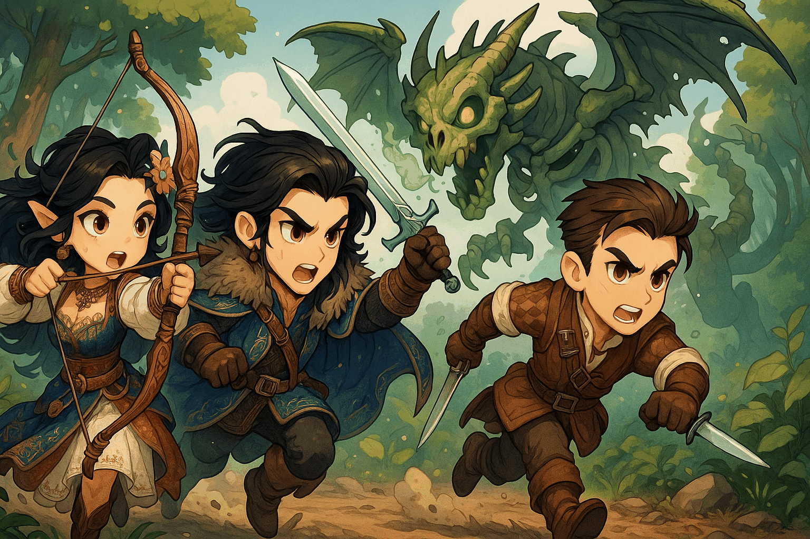
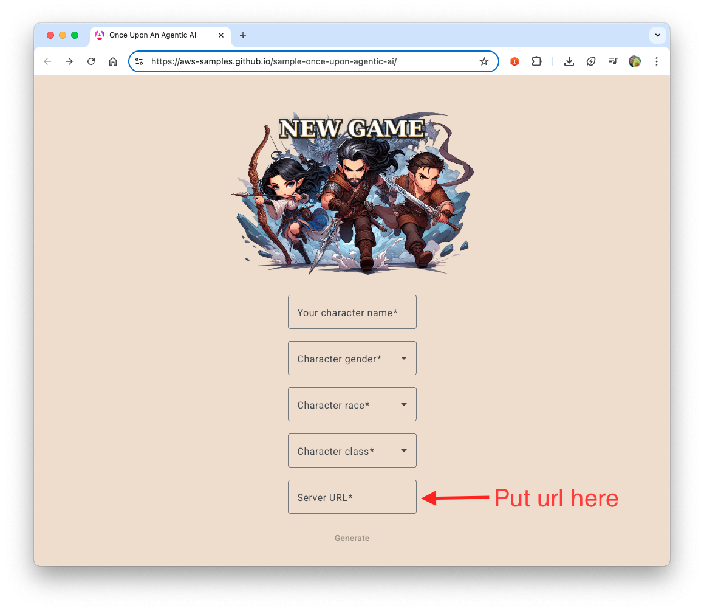

# 🎲 Chapter 6: Web Interface Testing



# 🎯 Quest Objective

You've built a Game Master with custom tools, an MCP server and subagents. Test it in real life with our basic web interface.

## Web Interface

Once the dice server, the Chroma server and your Game Master are running (the three terminals of [Chapter 5](5_subagents.md#step-5-launch-the-game-master)), use the web interface:

🌟 [Open the Web Interface](https://aws-samples.github.io/sample-once-upon-agentic-ai/)

The interface is the same one the Strands version of the workshop uses. Your Game Master serves the same endpoints and the same JSON, so it works unchanged.

### Connect Your Game Master

In the web interface:

1. Fill in your character: name, gender, race and class
2. In `Server URL`, enter the URL of your Game Master: `http://127.0.0.1:8009`
3. Click Start



The web interface runs in your browser and talks to the Game Master running on the same machine. Browsers let this HTTPS page reach `http://127.0.0.1:8009` because it is localhost, and the Game Master allows the cross-origin calls with the `cors` middleware.

**Monitor Performance:**
Watch your Game Master terminal to see how it processes each request. A turn looks something like this (abridged):

```
Processing request...
🔍 Searching for character with name: 'Arnaud'

🔧 Tool: character_agent {"request":"Find the character named Arnaud"}
✓ character_agent: Arnaud is a level 1 Human Fighter...

🔧 Tool: roll_dice {"faces":20}
✓ roll_dice: 14
...
{
  response: '...',
  actions_suggestions: [ ... ],
  details: '...',
  dice_rolls: [ ... ]
}
```

The Character Agent's own log lines (`🔍 Searching...`) come first because they print while the turn runs; the Game Master prints the turn's tool calls and its structured response once the turn is over.

**Customization ideas:**

- Modify system prompts to change your Game Master's personality
- Add new custom tools for different mechanics
- Integrate additional MCP servers for new capabilities
- Add a third subagent, for example one that keeps track of non-player characters

## Troubleshooting

**"Connection Refused" Error:**

- Verify your Game Master is running on port 8009
- Check that no firewall is blocking the connection

**"Invalid Server URL" Message:**

- Make sure the URL is exactly `http://127.0.0.1:8009`, with no space or path after the port
- Check for typos in the URL entry

**Error responses (HTTP 500):**

- Look at the Game Master terminal: `Error occurred: ...` gives the cause
- Check that the dice server (port 8002) and the Chroma server (port 8005) are still running
- Check that your AWS credentials have not expired

**Slow Response Times:**

- Monitor your local machine's resource usage
- Check your internet connection stability
- Each subagent call is a full agent run with its own model calls: a turn that asks two subagents takes longer than one that only rolls a die

# 🎉 Quest Complete!

Congratulations! You've connected your Game Master to a web interface and tested it end to end.

**What you've learned:**
- ✅ Connecting your local Game Master to the web interface
- ✅ Testing your agent's responses through the web interface
- ✅ Following your agent's tool calls in the terminal

**Next Adventure**: Explore [Chapter 7](7_deep_agents.md), where you rebuild the Game Master with Deep Agents!

---

_"A tested system is a system you can trust."_ 🎭✨
