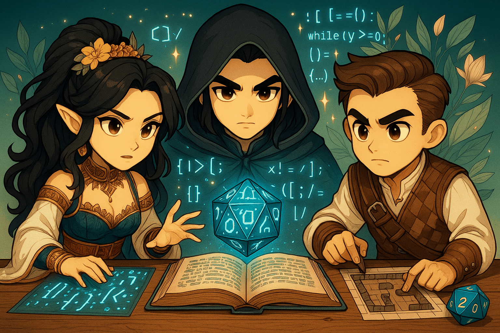

# 🛡️ Chapter 7: The Enchanted Armour - Deep Agents



# 🎯 Quest Objective

Across Chapters 1 to 5 you assembled the Game Master piece by piece: an agent, tools, an MCP server, subagents, structured output, a checkpointer. **[Deep Agents](https://docs.langchain.com/oss/javascript/deepagents/overview)** is the other way in: one call, `createDeepAgent()`, returns a pre-assembled agent with a tuned system prompt, a todo list, file tools, subagent delegation, conversation summarization and prompt caching. In this chapter you rebuild the Chapter 5 orchestrator with it, keeping the same API and the same web interface, and you compare the two.

Open and modify [`7_deep_agents/gamemaster_deep_agent.ts`](../7_deep_agents/gamemaster_deep_agent.ts).

## `createAgent` or `createDeepAgent`?

- **`createAgent`** (from `langchain`) is what you used so far: you assemble the agent yourself, tool by tool, middleware by middleware.
- **`createDeepAgent`** (from `deepagents`) is a pre-assembled agent built on `createAgent`. It returns the same kind of agent, invoked the same way, so everything you learned still applies. See the [Deep Agents quickstart](https://docs.langchain.com/oss/javascript/deepagents/quickstart).

Out of the box, `createDeepAgent()` gives you:

| Piece | Default |
|---|---|
| Model | the one you pass; here the same Claude Sonnet 4.6 on Bedrock as every other chapter |
| System prompt | your `systemPrompt`, plus Deep Agents' own instructions for its built-in tools |
| Planning | a `write_todos` tool, to plan multi-step work and track it |
| Files | `ls`, `read_file`, `write_file`, `edit_file`, `glob` and `grep`, on a virtual filesystem kept in the agent's state, not on your disk |
| Subagents | a `task` tool that delegates to your subagents, plus a general-purpose one |
| Context | long conversations are summarized automatically; prompt caching on Bedrock and Anthropic models |

These built-in tools cannot be removed. They are harmless here: the files are in the agent's state, not on your disk, and the Game Master simply doesn't need them. See [customize Deep Agents](https://docs.langchain.com/oss/javascript/deepagents/customization).

## Before You Start

Deep Agents reuses the services from Chapters 4 and 5. In two terminals, start the dice server (`npm run ch4:server`) and the Chroma server (`npm run ch5:chroma`), exactly as in Chapter 5. **Stop the Chapter 5 Game Master**: the new one takes its place on port 8009, so the web interface from Chapter 6 keeps working unchanged.

`deepagents` is already in the project dependencies: `npm install` installed it.

## Step 1: Create the Game Master with `createDeepAgent`

The file already holds what doesn't change: the HTTP API, the `StoryOutput` schema, the `INSTRUCTIONS`, the dice MCP client from Chapter 4 and a SQLite checkpointer. The Chapter 5 agents are imported as they are. What changes is the Game Master around them.

```typescript
// TODO: Step 1 - Import createDeepAgent from deepagents
```
```typescript
// TODO: Step 1 - Pass the INSTRUCTIONS as the systemPrompt
```

One import, one factory. Each option replaces something you wired by hand in Chapter 5.

`systemPrompt`: your domain text. Deep Agents adds its own instructions for its built-in tools, so keep yours narrow: who the agent is and which tool does what. Read `INSTRUCTIONS`: it tells the Game Master to use the `task` tool to reach its subagents.

## Step 2: Add the Dice MCP Tools

```typescript
// TODO: Step 2 - Add the dice MCP tools (await mcpClient.getTools())
```

`tools`: your own tools, next to the built-ins. The `mcpClient` is the Chapter 4 client, already created in the file.

## Step 3: Add the Subagents

```typescript
// TODO: Step 3 - Add the Chapter 5 rulesAgent and characterAgent as subagents: { name, description, runnable } for each
```

`subagents`: no more `subagentTool`. Deep Agents gives the Game Master one `task` tool: the model calls it with a subagent's name and a description of the job, and Deep Agents runs that subagent. Each subagent is described by a `name` and a `description`, the ones you gave the agents in Chapter 5 (`agent.options.name` and `agent.options.description`), and a `runnable`, the agent itself. See [subagents](https://docs.langchain.com/oss/javascript/deepagents/subagents).

## Step 4: Keep the Session on Disk

```typescript
// TODO: Step 4 - Keep the session on disk: pass the checkpointer (the session name is the thread id, below)
```
```typescript
// TODO: Step 4 - Name the session "dnd-campaign"
```

`checkpointer`: in Chapter 5 a `MemorySaver` kept the conversation in memory. Here the `checkpointer` already created in the file is a `SqliteSaver`, which saves every turn to `.agent/sessions.sqlite`. Pass it to the agent. Then, below the agent, create the `config` the endpoints use, `{ configurable: { thread_id: 'dnd-campaign' } }`: the thread id is the session's name. Start the server again with the same thread id and the campaign resumes. See [persistence](https://docs.langchain.com/oss/javascript/langgraph/persistence).

## Step 5: Force Structured Output

```typescript
// TODO: Step 5 - Force the response to use the StoryOutput schema (responseFormat: toolStrategy(StoryOutput))
```

`responseFormat`: the same option as in Chapter 5, so the web interface still gets the `StoryOutput` JSON it expects. This time it is wrapped in `toolStrategy(...)`, already imported from `langchain`, which states the strategy explicitly: the model returns the structured response by calling a tool named after the schema, the same mechanism the `.meta({ title: 'StoryOutput' })` of Chapter 5 was there for. See [structured output](https://docs.langchain.com/oss/javascript/langchain/structured-output).

## Step 6: Run and Compare

```bash
npm run ch7
```

You should see `D&D Game Master API (deepagents) listening on http://localhost:8009`. Ask it something, with curl or with the Chapter 6 web interface:

```bash
curl -X POST http://127.0.0.1:8009/inquire \
  -H "Content-Type: application/json" \
  -d '{"question": "Create a character named Thorin, a Dwarf Fighter. Roll his ability scores."}'
```

In the terminal, the subagent calls now show up as `🔧 Tool: task {...}`, with the subagent's name in `subagent_type` and the job in `description`, and you may see `write_todos` when the Game Master plans a longer job.

Then **stop the server (Ctrl+C), start it again**, and ask:

```bash
curl -X POST http://127.0.0.1:8009/inquire \
  -H "Content-Type: application/json" \
  -d '{"question": "Where did we stop last time, and what is my character called?"}'
```

Where did the campaign go between the two runs? Look at the `.agent/` folder that appeared at the repository root: `sessions.sqlite` is the checkpointer's database (the `-wal` and `-shm` files next to it are SQLite's working files). Every turn of every thread is saved there, under its thread id, `dnd-campaign` here. At start-up nothing is loaded; on the next request the checkpointer reads the latest checkpoint of that thread, and the agent picks up where it stopped. Change the thread id and you start a new campaign; the old one stays in the database. The folder is gitignored, so it stays on your machine.

**If every `/inquire` fails** after an error in the middle of a turn, the saved session may be broken: stop the server and delete `.agent/`. The campaign restarts from scratch.

**Chapter 5 vs Chapter 7:**

| | Chapter 5 (`createAgent`) | Chapter 7 (`createDeepAgent`) |
|---|---|---|
| Dice via MCP | `MultiServerMCPClient` + `getTools()` | same |
| Subagents | `subagentTool()` wraps each agent as its own tool | `subagents: [{ name, description, runnable }]`, all behind one `task` tool |
| System prompt | written by you, from scratch | Deep Agents' instructions + your `systemPrompt` |
| Model | Claude Sonnet 4.6 on Bedrock | same |
| Planning, files, summarization, caching | none | on by default |
| Session | `MemorySaver`, lost on restart | `SqliteSaver`, survives restarts |
| Structured output | `responseFormat: StoryOutput` | `responseFormat: toolStrategy(StoryOutput)` |

## When to Use Which

Reach for Deep Agents when its defaults fit and you want a capable agent quickly: long, multi-step jobs where planning, scratch files, delegation and context summarization pay off. Stay on `createAgent` when you need shapes Deep Agents doesn't assume: a minimal toolset, a prompt that is entirely yours, a custom middleware stack. The two compose: a Deep Agent's subagents can be plain `createAgent` agents, as the Rules and Character agents are here.

From here you can add any feature you want. Your Game Master could generate images of scenes and characters, remember non-player characters and their relationships, run a campaign for several players at once (one thread id each), invent new locations as the story needs them, track spell slots and experience points, read its narration aloud, or roll several dice of different types in one call to the dice server instead of one MCP call per die... Sky is the limit.

# 🎉 Quest Complete!

Congratulations! You rebuilt your Game Master with Deep Agents and saw exactly what it adds to the agent you wired by hand.

**What you've learned:**
- ✅ How Deep Agents relates to the `createAgent` you used in Chapters 1 to 5
- ✅ Rebuilding the Game Master API with `createDeepAgent` (system prompt, tools, subagents, structured output)
- ✅ Resuming a campaign across restarts with a SQLite checkpointer and a named thread
- ✅ When to pick Deep Agents and when to stay on `createAgent`

**Next Adventure**: Head to the [final cleanup](cleanup.md) page to stop your services and reflect on what you've built!

---

_"The greatest adventures are those we imagine and build ourselves."_ 🌟✨
