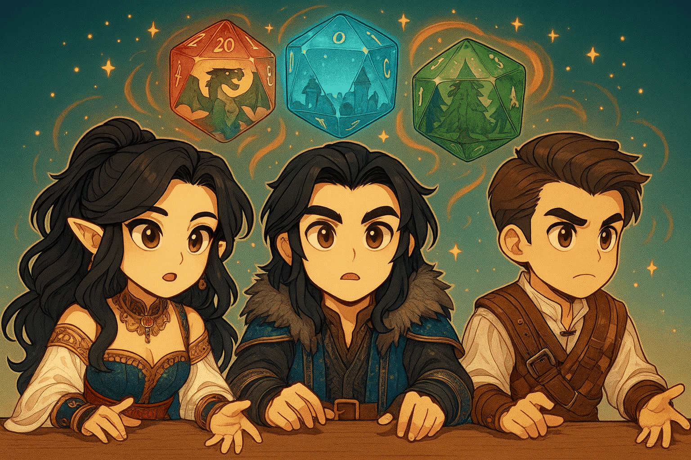

# 🧹 Final Cleanup



# 🎯 Quest Objective

Leave no trace behind: stop the local services and tidy up the files the workshop generated.

Good news first: this workshop creates no AWS resource. Everything ran on your machine and only called an Amazon Bedrock model, which is billed per call and costs nothing once you stop. This page is the last stop: whatever chapters you completed, everything to stop or delete is listed here.

## Amazon Bedrock

The workshop calls Amazon Bedrock models, so there is nothing to delete on the Bedrock side. Keep in mind:

1. **Model usage**: charges are based on usage (input and output tokens). Nothing accrues once you stop calling the model.
2. **Model access**: the access you enabled stays active but costs nothing unless used.

## Local services

Stop every server still running, with Ctrl+C in its terminal: the dice MCP server (`ch4:server`), the Chroma server (`ch5:chroma`), and the Game Master (`ch5:gamemaster` or `ch7`).

## Local files

Everything below was generated during the workshop. Run these from the repository root:

- `5_subagents/utils/DnD_BasicRules_2018.pdf` (the PDF you downloaded) and `5_subagents/utils/dnd_knowledge_base/` (the Chroma data). Both are gitignored, delete them freely.
- `.agent/`: the Chapter 7 session database. Gitignored, delete it freely.
- The scroll Kiro wrote in the Chapter 2 bonus quest, such as `fibonacci_scroll.py`, at the repository root.
- `5_subagents/agents/character_agent/characters.json`: the characters you created. **This file is tracked in git** (it ships with Arnaud), so restore it rather than deleting it:
  ```bash
  git restore 5_subagents/agents/character_agent/characters.json
  ```
- `node_modules/`, if you no longer need the dependencies.

`git status` shows anything else you created or changed along the way.

# 🎉 Quest Complete!

Congratulations, brave adventurer! You've journeyed through the entire LangChain.js workshop, from creating your first agent to orchestrating a complete multi-agent system with a web interface.

**What you've learned:**
- ✅ Creating AI agents with `createAgent` and equipping them with prebuilt and custom tools
- ✅ Gating risky tool calls behind human approval
- ✅ Connecting agents to tools served over MCP
- ✅ Orchestrating specialized subagents, with memory and structured output
- ✅ Testing your complete system through a web interface
- ✅ Rebuilding the same Game Master with Deep Agents

**Now Go Build Your Legend**: You've mastered the fundamentals. Go create something extraordinary of your own!

---

_"The apprentice has become the builder. Now go forth and create wonders!"_ 🗡️✨
